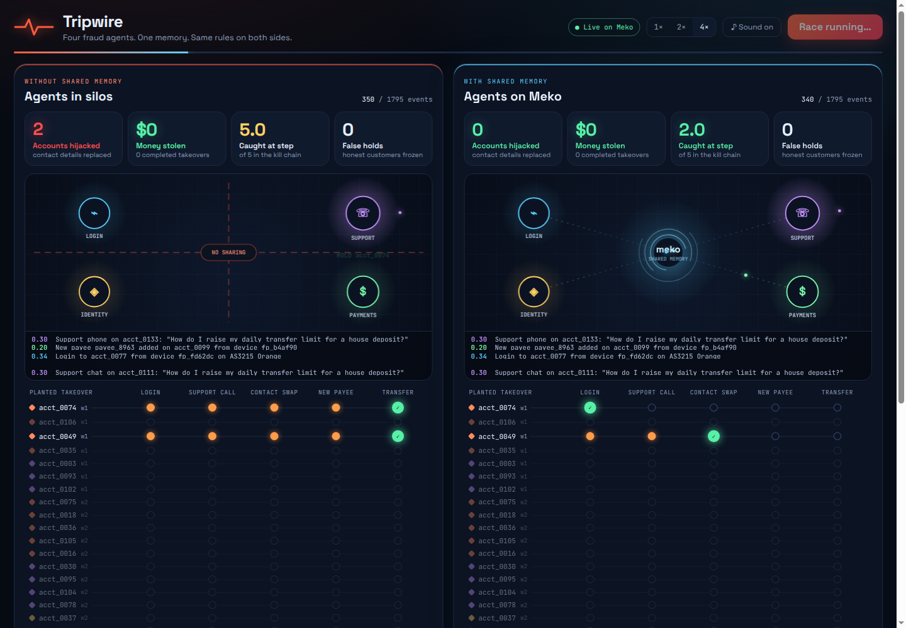

# Tripwire

**Four fraud agents. One memory.** An account takeover is five quiet steps, and no single agent sees more than one of them. Tripwire runs the same four agents twice over the same stream of banking events: once in silos, once sharing memory through the [Meko Context Engine](https://github.com/yugabyte/meko). Same scoring rules, same hold threshold. The only difference is memory.

| Seed 7: 1,795 events, 19 planted takeovers | Agents in silos | Agents on Meko |
|---|---|---|
| Accounts hijacked (contact details replaced) | **19 of 19** | **0 of 19** |
| Money stolen | **$9,569** in 5 completed takeovers | **$0** |
| Average step of the kill chain where the attack was caught | 4.4 of 5 | 1.8 of 5 |
| Honest customers frozen | 0 | 0 |

Built for [ContextCon: Remember Everything](https://www.hackerearth.com/challenges/hackathon/contextcon-remember-everything/). All data is synthetic.

**Live demo:** https://shijas786.github.io/tripwire/ replays a recorded run against Meko, with every stored decision trace, in the browser. Turn the sound on.



## Inspiration

Maya runs the fraud desk at a mid-size digital bank. Her bank already has agents: one watches logins, one reads support chats, one guards profile changes, one scores payments. Each is good at its job. Takeovers still get through, because the attacker's five steps land on five different desks: a login from a new device (the login agent shrugs, people buy phones), a "my phone was stolen abroad" chat (the support agent helps), a changed phone number, a new payee, a transfer. Every step alone looks like an honest customer. By the time the payments agent sees a large transfer, the victim's email and phone already belong to the attacker.

The agents do not need to be smarter. They need to remember together.

## What it does

- **Races silos against shared memory.** Both sides see the same seeded stream, live, side by side. You watch attacks crawl through the five steps on the left and get cut at the first or second step on the right.
- **Correlates across agents.** Each agent writes what it noticed to a shared Meko datapack. When another agent scores a later event on the same account, it recalls those signals and combines them with its own.
- **Remembers the attacker, not just the victim.** After an analyst confirms a takeover, the attacker's device, mule payee and social-engineering script are promoted to a confirmed-patterns datapack. The next victim's first login from that device is held on sight. A script is matched by meaning, so a paraphrased story from a brand-new device still counts against the caller.
- **Never freezes a customer on one signal.** A recovery request that merely sounds like a known script (an honest "I forgot my password" scores close to one) is not enough to hold. It takes independent signals from different agents, or a confirmed pattern.
- **Explains every hold.** Click any shield to open the decision trace: which agent contributed which factor, what was recalled from Meko, the playbook section retrieved, and the turn exactly as Meko stored it, with its plan, reasoning and every Meko call made for it.

## How Meko is used

Meko is the only memory the shared side has. Remove it and you get the left half of the screen.

| Meko feature | What Tripwire does with it |
|---|---|
| **Datapacks** | Two per run: *signals* (everything any agent noticed) and *confirmed patterns* (what analysts confirmed). Shared by all five agents. |
| **Multi-agent memory** (`memory_add`, `memory_search`) | Each of the four specialists writes under its own `agent_id` and reads the others' memories, scoped by account. |
| **Conversations** (`conversation_create`, `conversation_add_message`) | One case conversation per account and one per device, so recall is scoped to the case; plus a fraud-desk conversation for confirmations. |
| **Decision traces** | Every hold is stored as a turn with its plan, reasoning, the memories it used and the tool calls. The UI reads it back from `GET /api/v1/datapacks/:id/conversations/:conversation_id`. |
| **Promotion** (`memory_promote`) | Confirmed devices, mules and scripts are promoted so they outlive the case that produced them. |
| **Hybrid context search** (`context_search`) | One call returns confirmed patterns (exact device and payee IDs by keyword, scripts by vector similarity) and the relevant playbook section. |
| **Knowledge base** (`knowledgebase_upload_file`) | The two response playbooks in [`playbooks/`](playbooks) are uploaded and cited in decisions. |
| **Artifacts** (`artifact_put`) | An incident report per stopped takeover. |
| **Metrics** (`GET /api/v1/datapacks/:id/metrics`) | Token savings, request counts and context size, shown in the UI and in [`docs/results.json`](docs/results.json). |

About 1,000 Meko calls per run. Context that reached a decision averaged 32 tokens, against roughly 2,980 for the window of raw events an agent would otherwise have to read (estimated at 4 characters per token). Meko's own metrics reported 70% token savings on the confirmed-patterns datapack.

## How we built it

- `server/sim.js`: a seeded generator. 140 accounts, honest traffic with look-alike anomalies (new phones, VPNs, forgotten passwords, big one-off payments), and three crews that reuse what is expensive (devices, scripts) and rotate what is cheap (mule payees, networks). Wave 2 keeps transfers under each victim's "unusual" amount, and two crews use a fresh device per victim.
- `server/agents.js`: four specialists with deterministic, readable scoring, combined with a noisy-OR. Hold at 0.70.
- `server/memory.js`: `SiloMemory` (private notes per agent) and `MekoMemory` (the table above). The agents and the engine are identical for both.
- `server/engine.js`: runs the stream, asks the event's agent to score it, holds or lets it through, and feeds analyst confirmations back into memory after a delay.
- `server/index.js`: Express API, streams both runs to the browser over Server-Sent Events.
- `web/`: React, a canvas arena per side, Framer Motion, and sound synthesized with WebAudio.

No LLM is in the scoring loop on purpose: the comparison isolates memory, runs the same way every time, and costs nothing to reproduce. See [docs/ARCHITECTURE.md](docs/ARCHITECTURE.md).

## Run it

Needs Node 20+ and a running Meko.

```sh
curl -fsSL https://mekodata.ai/install.sh | sh   # installs Meko
meko start                                       # http://127.0.0.1:7777

git clone https://github.com/Shijas786/tripwire && cd tripwire
npm install
npm run dev                                      # http://localhost:5173
```

Tripwire reads the token from `meko token`. To point it somewhere else, set `MEKO_URL` and `MEKO_TOKEN`.

| Command | What it does |
|---|---|
| `npm run dev` | API on 8787 and the UI on 5173, live against Meko |
| `npm run bench` | Runs both modes headless and writes `docs/results.json` |
| `npm run record` | Records a run and its traces to `web/public/recording.json` for the hosted replay |
| `npm run build && npm start` | Production build served by the API on 8787 |
| `npm test` | Unit tests (no Meko needed) |

Without a reachable API the UI falls back to the recorded run, which is what the live demo serves.

## Challenges

- **Making the comparison fair.** The first version let the shared side win on a rule the silo side did not have. Now both sides run the same code and the only swap is the memory class.
- **Not cheating with easy attackers.** If attackers reuse everything, a blocklist wins. Wave 2 rotates mules and devices and stays under amount limits, so the shared side has to win on correlation and on meaning.
- **False positives.** An honest "I forgot my password and the reset email never arrived" is semantically close to a confirmed script. The fix was policy, not a threshold: a script match alone never holds.
- **Agent identity in Meko.** A conversation belongs to the agent that opened it; specialists write memories into shared case conversations under their own IDs.

## Accomplishments

A reproducible, measurable answer to "what does shared agent memory buy you": 19 hijacked accounts down to 0, with zero honest customers frozen, and a stored explanation for every hold.

## What we learned

Promotion changes how memory is served: promoted memories come back through hybrid search next to knowledge-base chunks, which is exactly what you want for confirmed facts that must match on an exact ID.

## What's next

- An LLM arbiter for the ambiguous middle band, with Meko's trace as its audit log.
- Analyst feedback on false holds, stored as counter-patterns.
- Cross-bank pattern sharing through a shared datapack.

## License

[MIT](LICENSE)
