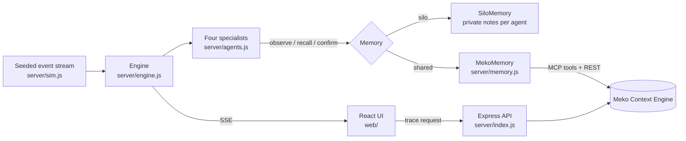

# Architecture

## One event, step by step

1. The engine hands the event to the specialist for its type (login, support, profile change, payee or transfer).
2. The specialist scores it with its own rules (`scoreLocal`), producing named factors such as `login.new_device`.
3. It asks memory what is already known (`recall`):
   - **Silo:** its own earlier notes on the account, and patterns it confirmed itself.
   - **Shared:** `memory_search` in the account's case conversation and the device's conversation (signals from every agent), and `context_search` on the confirmed-patterns datapack (promoted patterns and playbook sections).
4. Factors are combined with a noisy-OR, each distinct factor counted once. At 0.70 or more the account is held.
5. A signal worth remembering is written back (`observe`), under the specialist's own agent ID.
6. A hold is stored as a conversation turn with plan, reasoning and calls, plus an incident report artifact.
7. Some ticks later the analyst confirms the case. The attacker's device, mule and script are stored and promoted (`confirm`).

## Meko data model

| Object | Count per run | Holds |
|---|---|---|
| Datapack *signals* | 1 | Agent memories, case and device conversations, incident artifacts |
| Datapack *confirmed patterns* | 1 | Promoted patterns, two playbooks, the fraud-desk conversation |
| Conversation per account | 140 | Scopes signal recall to one case |
| Conversation per device | as seen | Finds a device moving across accounts |
| Agents | 5 | `login-sentry`, `support-listener`, `identity-warden`, `payments-hawk`, `arbiter` |

## Why the comparison is fair

- Both modes get the same events in the same order (same seed).
- Both use the same scoring rules, the same combiner and the same threshold.
- Both get the same analyst confirmations with the same delay. In silo mode a confirmation reaches only the agent that made the hold.
- Ground truth (`attack`, `truth`) is carried on events for scoring the result and drawing the lanes. Agents never read it.

## Measurements

- **Hijacked:** the attacker replaced the account's contact details (step 3) before any hold.
- **Stolen:** transfers that completed.
- **Context tokens:** characters of recalled evidence divided by 4. **Raw tokens:** the same for the last 220 events, the window an agent would need to read to find the same evidence unaided. Both are estimates; Meko's own `savings_pct` is reported next to them.

## The hosted replay

`npm run record` runs both modes against Meko and saves every message and every stored trace to `web/public/recording.json`. With no API reachable, the UI replays that file on a simulation clock, so the hosted demo shows a real run without exposing a Meko server.
